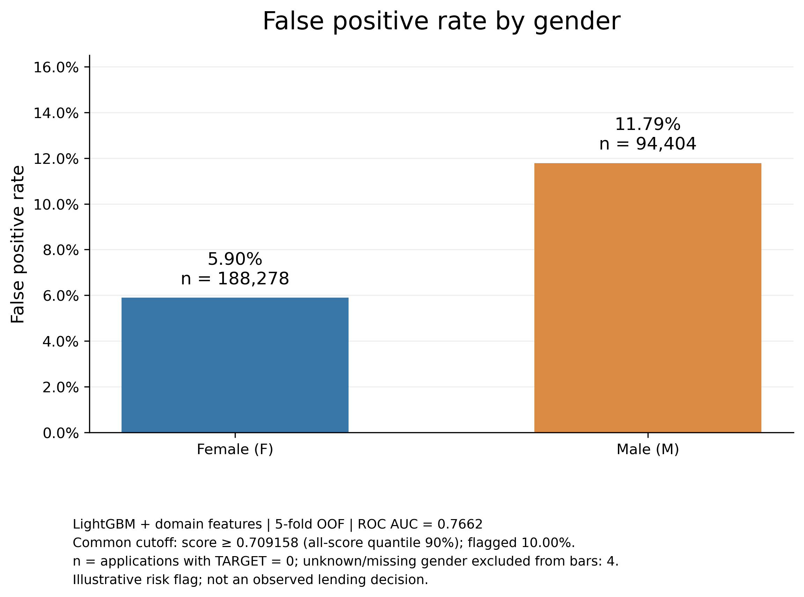

# Home Credit Audit｜小组进度 Debrief

更新：2026-11-18。给刚加入讨论的组员：先读第 1–4 节，再看图和第 6 节任务；不需要先读完长 notebook。

**我们正在做 DS-US 202 的 Responsible Data Science 项目：审计一个公开的贷款风险模型。当前已选定 LightGBM + domain features，导出全部有标签申请的 OOF scores，并完成第一项 gender FPR 对比。接下来要把这个 preliminary finding 做成 presentation，并扩展审计、整理 report 和 Colab。**

## 1. 我们为什么选这个项目？

项目对象是 Kaggle **Home Credit Default Risk** 比赛中的公开 baseline，代码来自 Will Koehrsen 的 *Start Here: A Gentle Introduction*（version 17）。我们借用已有模型，研究它的表现、不同群体承担的错误以及解释上的限制。原作者的建模工作与我们的兼容性修改、OOF 导出和审计分析需要分别署名。

这个场景的核心问题是：模型可能有不错的整体预测表现，但如果把分数用于贷款风险筛查，不同人群是否承担不同的错误负担？例如，一个实际没有出现目标 repayment difficulty 的申请人，被模型标成 high risk，可能在假设的审批流程里受到不利影响。

**边界：我们审计的是公开 competition model。仓库没有证据表明它是 Home Credit 实际部署的审批系统，也没有真实批准／拒绝记录。下文的 high-risk flag 是我们设置的模拟规则。**

## 2. 输入、输出和当前模型

| 项目 | 当前设置 |
| --- | --- |
| 训练数据 | `application_train.csv`：307,511 行、122 列（含 ID 和 TARGET） |
| 无标签测试数据 | `application_test.csv`：48,744 行、121 列 |
| 标签 | `TARGET=1` 表示 competition-defined repayment difficulty；正例约 8.07%。不要直接解释为破产或永久违约 |
| 输入 | 主申请表中的人口统计信息、收入、贷款金额、就业信息、`EXT_SOURCE_1/2/3` 等 |
| 当前范围 | 只使用 main application tables；没有整合 bureau、历史贷款等 auxiliary tables |
| 审计主模型 | LightGBM + domain features；其他 logistic regression/random forest 结果保留作 baseline 记录 |
| Domain features | 信贷金额／收入、年金／收入、年金／信贷金额、工作天数／年龄天数四个比值 |
| 训练与验证 | 5-fold `KFold`，shuffle，seed=50，`class_weight='balanced'`，early stopping |
| 输出 | 0–1 risk score，越高表示模型认为风险越高；尚不能当成已校准的实际概率 |

**OOF（out-of-fold）是什么？** 把有标签的数据分成 5 份，每次用其中 4 份训练，给剩下 1 份打分。最后每条申请都有一个来自“训练时没有使用该行”的模型分数，可与其真实 `TARGET` 对照。注意同一个 validation fold 也参与 early stopping，因此这是 exploratory CV audit，不是独立 final test。

根目录的 `baseline_*.csv`、`log_reg_baseline.csv` 和 `random_forest_*.csv` 是 **无标签 test predictions**。其中名为 `TARGET` 的列是预测分数，不能拿来当 ground truth 算 FPR。我们的审计使用 `audit_outputs/oof_lgb_domain_features.csv`。

## 3. 目前实际完成了什么？

| 状态 | 工作 | 证据／位置 |
| --- | --- | --- |
| 已有 | 原始 notebook、兼容性修改后的本地 notebook、proposal 文件 | `original/`、主 notebook、`HCDR_proposal.pdf` |
| 已有保存结果 | EDA、多个 baseline、domain LightGBM 的 5-fold 训练结果 | 主 notebook 与根目录 prediction CSV |
| 已完成 | 给 307,511 条有标签申请导出 OOF score | `audit_outputs/oof_lgb_domain_features.csv` |
| 已完成 | 按 `SK_ID_CURR` 一对一连接原始 `CODE_GENDER`，核对标签 | `audit_outputs/oof_with_gender.csv` |
| 已完成 | 同一个阈值下比较 F/M 的 FPR，生成 presentation 图 | 下表与 `audit_outputs/` |
| 待完成 | age、交叉群体、更多 outcome metrics、calibration、threshold sensitivity、稳定性与 ablation | 第 6 节 |
| 待整理／验证 | slides、draft report、可共享并运行的 Colab | 这些成品目前不在本仓库中 |

11 月 17 日新增的 audit 内容位于 notebook 末尾 **“NEW UPDATE — November 17, 2026”**。11 月 18 日交接时重新读取 CSV、核对原始 ID/标签/gender，并重算 AUC、阈值与 FPR，结果一致；这次交接没有重新训练整个 notebook，也没有验证完整 Colab runtime。

## 4. 第一项发现：同一阈值下的 gender FPR 不同

我们把**所有 OOF scores 的第 90 百分位数**作为统一阈值：`score >= 0.7091582611` 标为 high risk，约 10% 的申请被标记。它是 illustrative audit rule，并非贷款机构已知政策。

**FPR = TARGET=0 中被标为 high risk 的人数 ÷ TARGET=0 的总人数。** 它回答的是“没有发生该目标事件的人里，有多少被误报为高风险”，不是所有申请人的拒贷率。

| 原始 CODE_GENDER | 申请总数 | TARGET=0 人数（分母） | False positives | FPR |
| --- | ---: | ---: | ---: | ---: |
| F | 202,448 | 188,278 | 11,103 | 5.90% |
| M | 105,059 | 94,404 | 11,127 | 11.79% |

- 整体 OOF ROC AUC：**0.766186**。AUC 衡量区分／排序能力，不是 76.6% 的 accuracy。
- M − F 的 FPR 差：**5.89 percentage points**，M 约为 F 的 2 倍。
- 另有 4 条 unknown gender：保留在全量 OOF 和阈值计算中，不进入 F/M 两根柱子的比较。字段来自数据集记录，不代表对个人 gender identity 的推断。



Presentation 可以这样表述：

> 在 main-table LightGBM 模型中，以全部 OOF 分数的第 90 百分位作为统一高风险阈值，记录为 M 的群体 FPR 为 11.79%，记录为 F 的群体为 5.90%，相差 5.89 个百分点。这提示不同群体可能承担不同的误报负担，值得继续检查其他阈值、群体与指标。

**这个结果还不能说明什么？** 它没有证明真实拒贷差异、因果歧视或违法行为，也没有证明 gender 这个特征本身造成了差异。我们尚未报告 uncertainty intervals 或 seed stability。单看 FPR 也不能判断整个系统是否公平；还应看 TPR/FNR、群体构成、base rates、calibration 和具体决策情境。模型用了 class weighting，目前没有完成 calibration audit，`0.709` 不能解释为“70.9% 的实际违约概率”。

## 5. 最近需要交什么？

以下来自本地课程文件 `Project description (1).pdf`，交接时已核对；后续 Brightspace／TA 更新需由小组确认。时间为 ET，年份为 2026。

| 日期 | Deliverable | 我们需要补齐什么 |
| --- | --- | --- |
| **11 月 20 日，Lab** | 4–5 slides，3 分钟 presentation | Background、Input/Output、analysis plan、至少一个 early takeaway；每个人都要能讲 |
| **11 月 24 日 23:59** | Draft report PDF + Colab notebook | 完成 Background 和 Input/Output，写清后续分析计划、初步发现，吸收 presentation feedback |
| **12 月 15 日 23:59** | Final report、implementation、slides | Report 最多 10 页 + optional appendix，计算有 Colab 支撑 |
| **12 月 18 日 23:59** | 5 分钟 presentation video + slides | 解释发现与局限，不加速视频 |

课程文件首页概览与详细条目的 final deadline 有冲突；上表按详细条目安排，**final materials 先以 12 月 15 日为准，并向 TA 核实**。每组交一份，Gradescope 关联所有组员；project 无 late days。报告需要 AI Disclosure，另有个人 contribution statement。

建议这次 slides 的顺序：① 项目背景与审计问题；② 数据、模型输入输出；③ OOF 与审计方法；④ 上面的 FPR 图和解释；⑤ 局限与下一步（若只做 4 页，可合并方法和计划）。

## 6. 三位组员现在可以怎么接手？

下面是**建议分工，尚未指定人选或确认领取**。课程要求大家共同参与所有部分；可以分别主导，再交叉检查。每个人先确保自己能解释 TARGET、OOF、FPR 和“模拟阈值”这四件事。

| 工作包 | 近期交付 | 后续可扩展 |
| --- | --- | --- |
| A：Background 与来源 | 1 页背景 slide + report 背景段落；说明谁建了原模型、为什么审计、哪些是未知的真实部署信息 | 数据选择偏差、stakeholders、模型使用场景与限制 |
| B：Input/Output 与数据概况 | 1 页数据 slide；整理样本量、label imbalance、主要特征类型、缺失值与分布；解释 score 与 probability 的区别 | age 分组、gender × age；记录各组样本量与 base rate |
| C：Early takeaway 与分析计划 | 用现有 CSV 独立核对 FPR 的分子分母，写图的讲稿和局限；整理 Outcomes 计划 | threshold sensitivity、TPR/FNR、group AUC、calibration 与不确定性 |

模型／代码衔接工作：保留当前结果作为 baseline，整理可运行的 Colab 和依赖，支持大家按 ID join 新的群体字段。具体负责人在组会确认，不把建议当作已经完成的个人贡献。

建议优先级：

1. **先完成近期交付**：所有人读懂当前图，制作并排练 3 分钟 slides，整理 draft 的 Background、Input/Output。
2. **扩展已有 OOF 分析**：在几个统一阈值下比较 gender FPR/TPR；加入 age 和 gender × age，报告小群体样本量。大部分工作可直接使用现有 CSV。
3. **补足解释与可信度**：group AUC、calibration、置信区间；如果训练多个 seeds，比较结论是否稳定。
4. **视时间加入 ablation**：移除 gender／age 等属性或 `EXT_SOURCE_*` 后重新训练。去掉显式属性仍可能保留 proxy，不预先声称这样能消除差异。

Proposal 中 family status、education、多个 fairness metrics、attribution 等属于更广的计划，不能写成已经完成。当前 `proposal.tex` 还保留成员占位符，部分部署／完成情况措辞也需要在新报告中重新核实；这里保留原文件，不把它当作最新进度依据。

## 7. 文件导航

| 文件 | 用途 |
| --- | --- |
| [home_credit_baseline_local.ipynb](home_credit_baseline_local.ipynb) | 当前工作 notebook，含保存输出；末尾是新增 audit |
| [audit_summary.csv](audit_outputs/audit_summary.csv) | 整体 AUC、threshold、flagged share、unknown count、FPR gap |
| [gender_fpr_summary.csv](audit_outputs/gender_fpr_summary.csv) | 两组人数、分母、误报数量和 FPR |
| [domain_cv_metrics.csv](audit_outputs/domain_cv_metrics.csv) | 各 fold train/validation AUC 与整体 OOF AUC |
| `audit_outputs/oof_lgb_domain_features.csv` | 全量 `SK_ID_CURR, TARGET, oof_score`；新分析的基础 |
| `audit_outputs/oof_with_gender.csv` | 上述分数 + 原始 gender |
| `audit_outputs/gender_false_positive_rates.png` | 可用于 slides 的图 |
| `data/application_data.zip` | 两份原始 main-table CSV 的无损压缩包；先解压再运行 |
| `original/start-here-a-gentle-introduction_v17.ipynb` | 原作者 notebook，保留作来源参考 |
| `HCDR_proposal.pdf`、`proposal/proposal.tex` | 之前的 proposal 文件 |
| 根目录各模型 prediction CSV | 无标签 test predictions；不用于当前 subgroup ground-truth audit |

## 8. 如何查看／复现

### 只想了解结果

直接在 GitHub 阅读 README、图和小型 summary CSV 即可，不需要训练模型。完整 notebook 较长，优先定位末尾 November 17 update。

### 在本地准备数据和环境

```bash
git clone https://github.com/XXHEFEI/home-credit-audit.git
cd home-credit-audit
python -m zipfile -e data/application_data.zip data/
python -m venv .venv
source .venv/bin/activate
python -m pip install -r requirements.txt
jupyter lab
```

仓库为 private，须先拥有访问权限并完成 GitHub 登录。Windows 的环境激活命令为 `.venv\Scripts\activate`。从仓库根目录启动 notebook，默认 `DATA_DIR = 'data/'`。原始训练 CSV 约 166 MB，仓库保留约 42 MB 的 ZIP，解压后的 CSV 不进入 Git；本地已有 CSV 内容未改动。压缩包已通过 CRC 校验。

`requirements.txt` 是按 notebook imports 整理的依赖清单，**不是原训练环境的 lockfile**；全新环境和 Colab 仍需运行验证。不同软件版本可能带来数值变化。

### 不重新训练，只重算现有 audit

先运行 `DATA_DIR` 配置 cell，再运行末尾的 **“2. Reload the CSV and join the original gender field by application ID”**、**“3. Compare false positive rates at one common threshold”**、**“4. Presentation figure”** 对应 code cells。跳过前面的 Export cell：它需要训练产生的 `oof_domain`。

若仅做新群体统计，也可以直接读取 `oof_with_gender.csv`；新增 age 等字段要通过 `SK_ID_CURR` 与原始训练表一对一连接，并核对行数和标签，不能依赖当前行顺序。

### 重新训练选定模型

Notebook 已记录最小运行顺序，以当前文件中的 **1-based cell 位置**计：`2, 5, 8, 10, 28, 29, 31, 42, 44, 49, 79, 80, 116, 121`，随后运行 November 17 update 的全部代码 cells。插入新 cell 后位置会变，应结合标题和变量确认。这沿用 notebook 现有训练设置；当前 README 上传工作未重跑这条训练路径。

Colab 需要将 notebook、解压后的数据与已有 `audit_outputs/` 放在同一个项目目录下（例如 Drive），挂载 Drive 后调整 `DATA_DIR`。审计输出写在 `DATA_DIR` 父目录的 `audit_outputs/` 下。提交前要实际验证 Colab，不能把本地保存输出当成 Colab 已运行的证据。

## 9. 来源与协作记录

- 数据来源：[Home Credit Default Risk competition](https://www.kaggle.com/competitions/home-credit-default-risk)。保留来源与原始使用条款；本仓库用于 private 小组课程协作。
- 原始实现：[Will Koehrsen — Start Here: A Gentle Introduction](https://www.kaggle.com/code/willkoehrsen/start-here-a-gentle-introduction)，version 17。
- 当前进度以本仓库代码和 `audit_outputs/` 为依据。原 notebook 中的历史 leaderboard 分数和文字结论不是我们这次的实测结果。
- 本 README 在 AI 辅助下根据本地 notebook、输出文件与课程要求整理；报告的 AI Disclosure 应如实涵盖实际使用过程，并由全组核对。新实验请记录谁做了什么、参数／阈值、输出文件及验证方式，以便最终 contribution statement 有据可查。
